<div align="center">


<br />

[](https://github.com/senran-N/flow-guard/releases/tag/v0.2.0)
[](./test/real-world-regression.test.mjs)
[](https://modelcontextprotocol.io)
[](#polyglot--cross-boundary-bridge-matrix)
[-22d3ee?style=flat-square)](./package.json)
[](./LICENSE)

**Shared Wiring Contracts (`Blueprint ⇄ Verify`), Typed Evidenced Causality Graphs & Graph-Diff (`G_base ➔ G_curr`) Verification MCP Engine for AI Coding Agents**

[**简体中文**](./README.md) · [**English**](./README.en.md) · [**Quick Start**](#quick-start--installation) · [**MCP Tools**](#the-4-core-mcp-tools) · [**Capability Boundaries**](#capability-boundaries--static-vs-runtime-scope) · [**Benchmarks**](#real-world--task-benchmarks)

</div>

---

## Why FlowGuard?

FlowGuard helps AI coding agents maintain end-to-end visibility over **inputs, dispatch branches, state mutations, and downstream consumers** while editing local files—answering both **"what connections this task must establish"** and **"what concrete evidence proves they are wired"**:

| Core AI Wiring Problem | Typical Failure Mode | FlowGuard v0.2.0 Mechanism |
| :--- | :--- | :--- |
| **1. Implemented, Never Wired** | Exporting `newlyAddedFeature()` in an application without connecting any real runtime entry (`Source`), or computing results with no downstream consumer. | **Context-Aware Entry + Shared Wiring Plan**: Separates `library` mode (public exports are valid external contracts) from `application` mode (new exports require `reachableFromRuntimeSource` evidence or surface in `unwiredExports`). |
| **2. Updated Here, Missed Counterpart** | Adding a strategy without factory registration, updating frontend payload fields while the backend still reads legacy keys, saving config without `Load` recovery, or breaking untouched files by deleting a state reader/writer. | **Typed Evidenced Edges + `G_base ➔ G_curr` Graph Diff**: Separates `BRANCH_DISPATCH` siblings from `SEQ_CALL` sequential steps, and expands verification along graph edges to `impactedUntouchedFiles`. |
| **3. Control-Reachable, Data Ineffective** | Writing a new threshold to config & disk while `applyFilter()` still reads hardcoded `DEFAULT_THRESHOLD`, or routing production code into `sandbox/` experiments. | **3-Tier Evidence (`L1_STRUCTURAL` / `L2_DATA_FLOW` / `L3_BEHAVIORAL`)**: Verifies target fields actually flow into `consumerTarget` and blocks reverse `prod -> sandbox` dependencies. |
| **4. Broken Contracts or Band-Aids** | Deleting polymorphic hooks/`#[cfg]` targets as "dead code", or silencing warnings via dummy calls, empty `catch {}`, or `#[allow(dead_code)]`. | **Tri-State Verdicts (`SATISFIED / VIOLATED / INCONCLUSIVE`)**: Reports missing references as `NO_STATIC_CALLER_EVIDENCE` with explicit uncertainty and review before deletion and marks dynamic/external consumers `INCONCLUSIVE`. |

---

## 6-Layer Architecture (v0.2.0)

```mermaid
flowchart LR
  subgraph L1["1. Fault-Tolerant Lexer (lexer.mjs)"]
    A1["27 Source Extensions"]
    A2["Balanced Interpolation & Parens"]
  end

  subgraph L2["2. Call-Site & Data Probes (file-parser.mjs)"]
    B1["Passed Args / Return Flow / Branch Context"]
    B2["State R/W & Constant Fallback Probes"]
    B3["IPC / REST / WebView2 / Shared Memory"]
  end

  subgraph L3["3. 8-Channel Bridge Linker (bridge-linker.mjs)"]
    C1["TAURI / ELECTRON / WEBVIEW2_IPC"]
    C2["SHARED_MEMORY_IPC / EVENT_BUS"]
    C3["RPC / HTTP_REST / CONFIG + Payload Keys"]
  end

  subgraph L4["4. Typed Causality Graph (graph-builder.mjs)"]
    D1["7 Typed Edge Kinds + Line & Confidence"]
    D2["Application vs Library Dual Reachability"]
    D3["Field-Level Save ⇄ Load Symmetry"]
  end

  subgraph L5["5. Graph-Diff Engine (graph-diff.mjs)"]
    E1["SessionStart Snapshot or --base Git Ref"]
    E2["New vs Pre-Existing Broken Bridges"]
    E3["Expanded Scope (impactedUntouchedFiles)"]
  end

  subgraph L6["6. Tri-State Contract Verifier (wiring-contract + flow-verifier)"]
    F1["Shared flow_blueprint ⇄ flow_verify Plan"]
    F2["L1 Structural / L2 Data-Flow / L3 Behavioral"]
    F3["SATISFIED / VIOLATED / INCONCLUSIVE Report"]
  end

  L1 --> L2 --> L3 --> L4 --> L5 --> L6
```



---

## The 4 Core MCP Tools

FlowGuard exposes 4 cohesive tools over Model Context Protocol (`stdio` JSON-RPC 2.0, zero external dependencies):

1. **`flow_overview`** — **Global Architecture Vision**: Profiles `workspaceProfile` (`application` / `library` / `hybrid`), maps `ENTRY_SURFACE`, `ORCHESTRATION_ROUTING`, and `INFRA_SINK` domains, extracts Top 8 `backbonePipelines` and `architecturalHubs`, and inventories `stateOwnership` (SSOT) + `extensionAndReserveCatalog`.
2. **`flow_trace`** — **Evidenced Relation & Impact Tracer**: Classifies edges into `CONTAINS`, `SEQ_CALL`, `BRANCH_DISPATCH`, `REGISTRATION`, `STATE_RW`, `IMPLEMENTS`, and `PROTOCOL_BRIDGE` with `file:line`, `passedArgs`, `returnFlow`, and `confidence` (retaining `candidates` on `AMBIGUOUS` matches). Strictly separates `siblingBranchesToCheck` from `sequentialStepsInCaller`, and finds reusable code via normalized lexical shingle Jaccard similarity (`LEXICAL_SHINGLE_JACCARD`).
3. **`flow_blueprint`** — **Shared Task Wiring Plan Generator**: Given a reference module (plus optional `targetSymbol`, `targetField`, `consumerTarget`, `requirePersistence`), generates a 4-station checklist and persists an active `wiringPlan` (`obligations` + `ambiguitiesToConfirm`) consumed directly by `flow_verify`.
4. **`flow_verify`** — **Graph-Diff & Tri-State Contract Verifier**: Evaluates the active `wiringPlan` and `G_base ➔ G_curr` diff (against `SessionStart` snapshot or `baseRef` / `--base <git-ref>`), leading with `SATISFIED / VIOLATED / INCONCLUSIVE` obligation counts, L1/L2/L3 evidence tiers (with optional `runTestsCommand`), `impactedUntouchedFiles`, and evidence-graded dead-code classification (`NO_STATIC_CALLER_EVIDENCE`, with analysis scope and uncertainty).

---

## Capability Boundaries & Static vs. Runtime Scope

- **Lexical, Import & Convention Inference**: Call edges and cross-language bridges are inferred from fault-tolerant lexical analysis, import/re-export resolution, receiver hints, and naming conventions. Under complex overloading, dynamic reflection, or multi-service identically named RPC methods, FlowGuard marks edges `AMBIGUOUS` with `candidates` and reports `INCONCLUSIVE` rather than guessing.
- **Normalized Lexical Shingle Similarity**: `LEXICAL_SHINGLE_JACCARD` compares normalized token/character shingles after stripping comments and literals—useful for surfacing likely clones and reusable helpers, not formal AST semantic equivalence.
- **Complementary to Runtime Tests & Probes**: In systems involving C++/CUDA kernels, thread synchronization, native resource/shared-memory lifetimes, or numerical accuracy, static L1/L2 checks verify structural and field-level wiring while **L3 behavioral correctness still requires unit/integration tests and runtime probes** (linkable via `runTestsCommand`).
- **Smart Hook Policy**: The `Stop` hook blocks strictly on **newly introduced `VIOLATED` contracts/breaks**—never on `INCONCLUSIVE` items or `preExistingBrokenBridges`—and supports `FLOWGUARD_MODE=advisory`.

---

L2 argument evidence preserves literal slots, duplicate arguments, and multiple call sites, matching a target field to the corresponding parameter read by the consumer. Ambiguous targets and spread bindings remain `INCONCLUSIVE`. Static reads do not prove an effect on the final output.

L3 stays `INCONCLUSIVE` until `runTestsCommand` / `--run-tests` actually executes, even if test code references the target. An explicit command runs even without an active blueprint. Exit 0 records command success; callers remain responsible for selecting tests that cover the intended behavior.

## Polyglot & Cross-Boundary Bridge Matrix

- **27 Extensions across 11+ Language Families**: TypeScript/JS/Vue/Svelte (including Svelte 5 Runes), Rust, Go, Python, C#, Java/Kotlin/Dart, Swift, PHP, Ruby, and C/C++/CUDA (`.c`, `.cpp`, `.cc`, `.h`, `.hpp`, `.cu`, `.cuh`).
- **8 Cross-Language / Cross-Process Bridge Channels**:
  1. `TAURI_IPC` (`invoke` ⇄ `#[tauri::command]` + payload field checks)
  2. `ELECTRON_IPC` (`ipcRenderer` ⇄ `ipcMain`)
  3. `WEBVIEW2_IPC` (`window.chrome.webview` ⇄ C++/C# `WebMessageReceived / PostWebMessageAsJson`)
  4. `SHARED_MEMORY_IPC` (Win32 `CreateFileMapping` / POSIX `shm_open` ⇄ Python `mmap / shared_memory`)
  5. `RPC_SERVICE` (ConnectRPC / gRPC with service-prefix disambiguation & candidate retention)
  6. `EVENT_BUS_BRIDGE` (`emit` / Socket.io `ws:*` ⇄ `listen` / `on`)
  7. `HTTP_REST_API` (method-aware dynamic routes + request payload field checks)
  8. `SHARED_CONFIG_BRIDGE` / `ENV_VAR_BRIDGE`

---

## Real-World & Task Benchmarks

- **Real-Task Incomplete-Wiring Benchmark (`test/task-benchmark-suite.mjs`, 75 assertions)**:
  - **8 Incomplete-Wiring Tasks (`8 / 8 = 100%` Recall)**: Unwired exported app feature, config threshold saved while filter still reads legacy constant, unregistered strategy mode, frontend-backend payload field drift, save without load recovery, missed Linux platform branch, writer deletion stranding untouched reader, and reader deletion turning untouched writer into dead state.
  - **6 Legal Counterexamples (`0 / 6 = 0%` False Violations)**: Public library exports, `#[cfg]` platform-specific implementations, one-way events / dynamic plugins (`INCONCLUSIVE`), write-only telemetry sinks, C++/CUDA + WebView2 + Shared Memory closed loop, and pre-existing broken bridges isolated from clean diffs.
- **Adversarial Torture Suite (`test/torture-suite.mjs`, 72 assertions)**: Polyglot syntax, injected defects, and Hook/MCP contracts.
- **Engine Integrity (`test/engine-integrity.test.mjs`, 23 test cases)**: Runtime reachability, Git/session baselines, task isolation, invalid state, and process failures.
- **Verification Regressions (`test/verification-regression.test.mjs`, 21 test cases)**: Argument positions, duplicate arguments, ambiguous bindings, actual behavioral test execution, CLI options, and exit codes.
- **Real-Repository Regressions (`test/real-world-regression.test.mjs`, 36 test cases)**: Prototype names, generics, scopes, conditional branches, package boundaries, interface contracts, report consistency, and exact similarity indexing.
- **Other language, configuration and transport regressions (60 test cases)**: TS inheritance and cache invalidation, Rust cross-crate paths/receivers/cfg, Vue events, FastAPI dependencies, framework entries and MCP.

Recall and false-violation figures apply only to these fixed fixtures, not to arbitrary repositories. Assertion counts are not counts of independent defects. Use `npm test` for timings on your machine.

The 2026-11-11 frozen baseline covers 72 scans of 36 real repositories and 12 defect/control pairs in copies of eight repositories. Thirty-three repositories completed with identical reports across both runs; three failed to finish both runs. Default incremental verification produced relevant diagnostics for 11/12 defects but targeted violations for only 2/12. Blueprint execution errors and source-confirmed false positives also remain, so this baseline is not ready for an automatic production gate. See the [versioned report](./benchmark/results/2026-11-11/REPORT.md) and [reproduction instructions](./benchmark/README.md). Results apply to the recorded source hash; later fixes require fresh evaluation.

The [latest retest report](./benchmark/results/2026-11-13-phase13/REPORT.md) covers Rust module imports, tool-script consumers and real-source disconnect cases. The [previous report](./benchmark/results/2026-11-12-phase7/REPORT.md) remains available for comparison. Remaining work is tracked in the [hardening record](./benchmark/HARDENING.md).

The earlier [performance candidate](./benchmark/results/2026-11-12-phase8/REPORT.md) increased measured latency and memory use and was reverted; this version does not include those changes. Large-repository timeouts and unreviewed residual findings remain unresolved.

---

## Quick Start & Installation

```bash
# Antigravity / Gemini Plugin
git clone https://github.com/senran-N/flow-guard.git ~/.gemini/config/plugins/flow-guard

# CLI Usage
node src/server.mjs --cli overview /path/to/your-repo
node src/server.mjs --cli trace /path/to/your-repo TargetSymbol
node src/server.mjs --cli blueprint /path/to/your-repo ReferenceSymbol --target NewSymbol --field threshold --consumer applyFilter --persist
node src/server.mjs --cli verify /path/to/your-repo --base HEAD~1
node src/server.mjs --cli verify /path/to/your-repo --full
node src/server.mjs --cli verify /path/to/your-repo --run-tests "npm test"

# Run the 147 assertions plus 156 verification/engine/real-world regression cases
npm test
npm run verify:self
```

CLI exit codes: `0` means `SATISFIED` (or an explicitly accepted advisory `INCONCLUSIVE`), `1` means a verification violation or test failure, `2` means an argument or execution error, and `3` means `INCONCLUSIVE`. To preserve the former advisory exit-`0` behavior for an inconclusive report, pass `--allow-inconclusive` or the JSON boolean `allowInconclusive: true`; the JSON report still states `status: "INCONCLUSIVE"`, and the option never suppresses violations or execution errors. Unknown options and missing option values are rejected. A single JSON argument remains supported; `--project-mode` accepts `auto`, `application`, `library`, or `hybrid`.

---

## Session State and Execution Evidence

`CONTAINS` and `IMPLEMENTS` describe architecture without making member methods runtime-reachable. Confirmed static call paths and possible/ambiguous paths are reported separately. Neither is runtime coverage.

An invalid explicit `baseRef` fails rather than falling back to HEAD; `baseline` reports the actual reference and commit. Session snapshots compare source content hashes, including existing-file edits in non-Git workspaces, and exclude dirty changes already present when the task began.

Use matching `sessionId` / `taskId` in MCP calls, `--session` / `--task` in CLI calls, or `FLOWGUARD_SESSION_ID` / `FLOWGUARD_TASK_ID`. Omitted IDs use `default`; concurrent tasks must supply distinct IDs. Hooks use `sessionId` or `conversationId`, plus `taskId`. State is scoped to workspace/session/task and published by atomic replacement. Branch changes, expiration after 7 days, corruption, or scope mismatch invalidate state and appear in `stateDiagnostics`. Regenerate legacy snapshots/plans. Workspace resolution no longer uses a global last-workspace file; provide `workspaceRoot`, initialize a workspace, or set the working directory.

`testTimeoutMs` / `--test-timeout` accepts 1–3600000 ms (default 60000). Runs distinguish `PASSED`, `TEST_FAILED`, `EXECUTION_ERROR`, `TIMED_OUT`, and `OUTPUT_LIMIT`. Timeout/output overflow terminates the test process tree. Execution errors remain behaviorally `INCONCLUSIVE` and exit 2 in CLI. Nonzero test exit codes indicate process failure; they do not identify a particular failed assertion.

`execution.artifactPath` points to a durable JSON record in `PLUGIN_DATA` or the system temp directory, containing the command, cwd, timings, exit status, signal, and stdout/stderr (combined limit 1 MiB; only tail excerpts appear in the report). Apply your own retention policy to these records. Consumers of the former safe-to-delete enum should migrate to `NO_STATIC_CALLER_EVIDENCE` and review uncertainty before removing code.

---

## License

Released under the [MIT License](./LICENSE). Copyright © 2026 [senran-N](https://github.com/senran-N).

See [operation and acceptance instructions](./OPERATIONS.md) for supported usage and exit codes.
