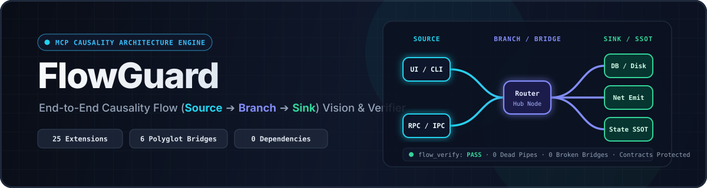

<div align="center">



<br />

[](https://github.com/senran-N/flow-guard/releases/tag/v0.1.1)
[](./test/torture-suite.mjs)
[](https://modelcontextprotocol.io)
[](#polyglot--cross-boundary-bridge-matrix)
[-22d3ee?style=flat-square)](./package.json)
[](./LICENSE)

**End-to-End Causality Flow (`Source ➔ Branch ➔ Sink`) Architecture Vision, Polyglot Bridge Linker & Incremental Flow Verifier MCP Engine for AI Coding Agents**

[**简体中文**](./README.md) · [**English**](./README.en.md) · [**Quick Start**](#quick-start--installation) · [**MCP Tools**](#the-4-core-mcp-tools) · [**Benchmarks**](#real-world-benchmarks-33-repos--130981-symbols)

</div>

---

## Why FlowGuard?

When operating in large polyglot codebases, AI coding agents relying solely on `grep` and local file reads frequently fall into three structural traps:

| AI Coding Pitfall | Typical Failure Mode | FlowGuard Solution |
| :--- | :--- | :--- |
| **1. Half-Wired Code (Broken Flow)** | Code written in isolation is wired to a superficial caller without reaching a true input `Source` or a side-effect `Sink` (persistence, network emit, UI state), or writes to state that is never read (`Write-Only Dead State`). | **`flow_blueprint` + `flow_verify`**: Generates a 4-station wiring checklist before coding and runs a 9-dimension causality flow audit before completion. |
| **2. Missed Parallel Branches** | Updating one branch or frontend call while forgetting sibling branches under the same router (`Branch`), polymorphic peers, or cross-language IPC/RPC counterparts. | **`flow_trace`**: Computes the **transitive `blastRadius`**, sibling branches, polymorphic peers, and 6-channel cross-language bridges in a single call. |
| **3. Dead Code vs. Reserved Contracts** | Leaving orphaned dead functions after refactoring—or conversely, mistakenly deleting framework lifecycle hooks, interface implementations, or `#[cfg]` conditional targets as "dead code". | **`reservedContracts` Immunity**: Strictly separates **reserved architectural contracts & polymorphic alignment parameters** from genuine **unwired dead pipes (`unwiredOrDeadPipes`)** and local `dataFlowBreaks`. |

---

## 5-Layer Causality Engine Architecture


---

## The 4 Core MCP Tools

FlowGuard exposes 4 high-signal tools over the standard Model Context Protocol (`stdio` JSON-RPC 2.0, zero external dependencies):

1. **`flow_overview`** — **Global Architecture Vision**: Maps the repository into `ENTRY_SURFACE`, `ORCHESTRATION_ROUTING`, and `INFRA_SINK` domains, extracts the Top 8 end-to-end `backbonePipelines`, ranks `architecturalHubs`, inventories `extensionAndReserveCatalog`, and identifies Single Source of Truth (`stateOwnership`) writers.
2. **`flow_trace`** — **Pre-Edit Impact & Causality Tracer**: Given any function, class, file, or state field, returns its `blastRadius`, per-parameter consumption matrix (`parameterFlowMatrix`), upstream sources, downstream sinks, sibling branches, polymorphic peers, and AST-similar reusable functions.
3. **`flow_blueprint`** — **4-Station Wiring Blueprint**: Given a reference module, generates an actionable checklist covering (1) Container/Registry mounting, (2) Upstream dispatcher routing, (3) Symmetric lifecycle pairs (`Save/Load`, `Send/Receive`), and (4) Downstream sinks.
4. **`flow_verify`** — **9-Dimension Incremental Flow Verifier**: Audits broken cross-language bridges, sandbox reverse-dependency leaks, local data-flow breaks, unwired dead pipes, reserved contracts, write-only dead states, asymmetric lifecycles, structural clones, and error-swallowing anti-patterns.

---

## Polyglot & Cross-Boundary Bridge Matrix

- **27 File Extensions across 11+ Language Families**:
  - **TypeScript / JavaScript / Frontend**: `.ts`, `.tsx`, `.mts`, `.cts`, `.js`, `.jsx`, `.mjs`, `.cjs`, `.vue`, `.svelte` (including Svelte 5 Runes `$props` / `$derived` / `.svelte.ts` and Vue Options/Composition API)
  - **Rust**: `.rs` (`#[tauri::command]`, `#[command]`, `#[specta::specta]`, inline `#[cfg(test)]` isolation, raw strings `r#"..."#`)
  - **Go**: `.go` (receiver methods, `interface` contracts, auto-filtering generated `*.pb.go` / `*.connect.go`)
  - **Python**: `.py` (FastAPI `APIRouter` mounts, `@*.register*` plugin decorators, indentation bounds, `f"""..."""` balanced interpolation)
  - **C#**: `.cs` (`unsafe` modifiers, `$@"..."` nested-quote interpolation, `ref`/`out`, delegate/event signatures, Unity/Harmony hooks)
  - **Java / Kotlin / Dart**: `.java`, `.kt`, `.dart` (Spring/Retrofit annotations, KMP source-set zoning, Dart promoted constructors & `package:` imports)
  - **Swift**: `.swift` (`extension`, bodyless `protocol`, `init`, metatype defaults, `\(...)` interpolation)
  - **PHP**: `.php` (PHP 8 promoted constructor properties, `#[Route]` / Laravel `routes/api.php`, `$this->field` state tracking, `{$this->field}` interpolation)
  - **Ruby**: `.rb` (paren-less `def`, `attr_accessor`, `@@class_var`, `@ivar` state tracking, `#{...}` interpolation)
  - **C / C++ / CUDA**: `.c`, `.cpp`, `.cc`, `.h`, `.hpp`, `.cu`, `.cuh` (multi-brace initializers, non-`const` ref out-params, atomic/CUDA side-effects, `cpp-httplib` routes)
- **6 Cross-Language Bridge Channels**: `TAURI_IPC`, `RPC_SERVICE` (ConnectRPC/gRPC), `EVENT_BUS_BRIDGE` (including Socket.io `ws:*`), `ELECTRON_IPC`, `HTTP_REST_API` (dynamic route normalization `/api/memos/${id}` ⇄ `/api/memos/{id}`, OpenAPI SDKs, C++ `ctx_http`), and `SHARED_CONFIG_BRIDGE` / `ENV_VAR_BRIDGE`.

---

## Real-World Benchmarks (33 Repos · 130,981 Symbols)

Stress-tested across **33 flagship open-source repositories** (**18,795 source files · 130,981 symbols · 566 cross-language bridges**), achieving **29 / 33 zero-false-positive `PASS`** while catching verified upstream bugs in the remaining 4 (`llama.cpp`, `bruno`, `Dapper`, `pocketbase`):

| Category | Repositories | Stack | Symbols | Source Reachability | Bridges Linked | Highlights |
| :--- | :--- | :--- | :---: | :---: | :---: | :--- |
| **Systems & C++/CUDA** | **ggml-org/llama.cpp** | C++ / CUDA (`.cu`/`.cuh`) / Python / Svelte | 29,279 | **99.8%** | `48` (`HTTP_REST` + `ENV_VAR`, 0 broken) | Only 2 `IGNORED_PURE_CALL`s in 29K symbols—both genuine missing `GGML_ASSERT` in `solve_tri.cu` |
| **Desktop IPC Products** | **clash-verge-rev** / **pot-desktop** / **SwitchHosts** / **bruno** | Rust+TS (Tauri) / Electron+React | 16,660 | **97.4% – 99.6%** | `325` (`TAURI_IPC` / `ELECTRON_IPC`) | 321 connected cleanly; caught 4 genuine orphaned Electron IPC channels in `bruno` |
| **Full-Stack Web Systems** | **usememos/memos** / **koel** / **uptime-kuma** / **fastapi-template** / **pocketbase** | Go / PHP / Python / Node + React / Vue / Svelte | 18,378 | **99.1% – 99.9%** | `193` (`RPC` / `REST` / `Socket.io`, 0 broken) | Method-aware REST, Laravel/FastAPI sub-routers & Socket.io linked with 0 false breaks |
| **Specialty & Core Libraries (23)** | `bits-ui` (Svelte 5 Runes), `BepInEx` (Unity/Harmony), `ripgrep`, `axum`, `zod`, `fastapi`, `gin`, `okhttp`, `Alamofire`, `dio`, `sidekiq`, `fmt`, `jq`, etc. | Svelte 5 / C# / Rust / Go / Kotlin / Swift / Dart / Ruby / C | 66,664 | **99.7% – 100%** | Full export, trait & Harmony hook coverage | 22 `PASS` cleanly; caught 3 genuine dead local assignments in `Dapper` |
| **Adversarial Torture & Contract Suite** | **`test/torture-suite.mjs`** | 11+ Lang Torture + 8 Fault Mutations + Hook/MCP Contracts | 69 Assertions | **100% Precision & Recall** | All channels + lifecycle hooks | **~ 1.2 s** |

---

## Quick Start & Installation

### 1. Antigravity / Gemini Plugin

```bash
git clone https://github.com/senran-N/flow-guard.git ~/.gemini/config/plugins/flow-guard
```

### 2. Claude Code / Cursor / Windsurf / Any MCP Client

```json
{
  "mcpServers": {
    "flow-guard": {
      "command": "node",
      "args": ["/path/to/flow-guard/src/server.mjs"]
    }
  }
}
```

### 3. Standalone CLI & Self-Verification

```bash
node src/server.mjs --cli overview /path/to/your-repo
node src/server.mjs --cli trace /path/to/your-repo TargetSymbol
node src/server.mjs --cli blueprint /path/to/your-repo ReferenceSymbol
node src/server.mjs --cli verify /path/to/your-repo
node src/server.mjs --cli verify /path/to/your-repo --full

# Run the 11+ language adversarial torture, mutation fuzzing & contract suite (69 assertions)
npm test
npm run verify:self
```

---

## License

Released under the [MIT License](./LICENSE). Copyright © 2026 [senran-N](https://github.com/senran-N).
