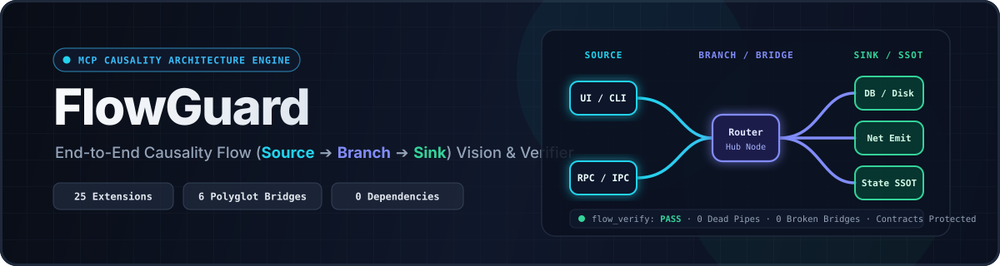

<div align="center">



<br />

[](https://github.com/senran-N/flow-guard/releases/tag/v0.1.1)
[](./test/torture-suite.mjs)
[](https://modelcontextprotocol.io)
[](#-%E5%A4%9A%E8%AF%AD%E8%A8%80%E4%B8%8E%E8%B7%A8%E8%BE%B9%E7%95%8C%E6%A1%A5%E6%8E%A5%E7%9F%A9%E9%98%B5)
[-22d3ee?style=flat-square)](./package.json)
[](./LICENSE)

**面向 AI 编码智能体（Coding Agents）的端到端因果水路（`Source ➔ Branch ➔ Sink`）架构视野、跨语言桥接与增量通水验收引擎**

[**简体中文**](./README.md) · [**English**](./README.en.md) · [**快速开始**](#-快速安装与接入) · [**MCP 工具矩阵**](#-四大核心-mcp-工具) · [**33 仓实战基准**](#-实战基准测试33-仓--130981-符号)

</div>

---

## 💡 为什么需要 FlowGuard？

在大规模、多语言生产仓库中，仅依赖 `grep` 和局部文件阅读的 AI 智能体极易陷入三大工程顽疾：

| 传统 AI 编码顽疾 | 典型故障现场 | FlowGuard 根治机制 |
| :--- | :--- | :--- |
| **1. 半截接入（断流）** | 在沙盒或局部文件写完函数后，只挂了表面调用，未接通真实输入源（`Source`）或未落盘/发包/更新 UI（`Sink`）；或写了状态却无人读取（Write-Only 死水状态）。 | **`flow_blueprint` + `flow_verify`**：生成四站式施工单，并在交卷前自动执行端到端通水试验，精准拦截未通水源/终端的断流节点。 |
| **2. 改 A 漏 B（漏支流）** | 修改某一模式或前端调用时，遗漏同一分流阀（`Branch`）下的并列支流、多态同族实现（`polymorphicPeers`）或跨语言 IPC/RPC 对端。 | **`flow_trace`**：一次性透视目标符号的**传递性爆炸半径（`blastRadius`）**、同级分流支路、多态同族及 6 类跨语言桥接对端。 |
| **3. 废管堆积与误删预留契约** | 重构后旧函数沦为零水流孤岛却未清理；或者反过来，把框架钩子、接口实现、条件编译（`#[cfg]`）或预留扩展参数当成“死代码”误删。 | **`reservedContracts` 智能豁免**：将**预留架构契约/多态对齐参数**与真正的**零水流废管（`unwiredOrDeadPipes`）/局部死变量（`dataFlowBreaks`）**严格分离。 |

---

## 🏗️ 引擎五层因果架构

```mermaid
flowchart LR
  subgraph L1["1. 多语言容错词法层 (lexer.mjs)"]
    A1["27 种源码后缀扫描"]
    A2["全语言字符串插值保留 (Template / f-string / Raw)"]
    A3["JSX / 泛型 / 嵌套括号平衡定界"]
  end

  subgraph L2["2. 符号与边界信号提取 (file-parser.mjs)"]
    B1["函数 / 类 / 接口 / 状态字段提取"]
    B2["行级精确 (offsetToLine) 跨界探针"]
    B3["局部死变量 / 裸调忽略返回值检测"]
  end

  subgraph L3["3. 六通道跨语言桥接器 (bridge-linker.mjs)"]
    C1["TAURI_IPC (Rust command ⇄ Frontend invoke)"]
    C2["RPC_SERVICE (ConnectRPC / gRPC)"]
    C3["EVENT_BUS (emit ⇄ listen 自定义协议)"]
    C4["ELECTRON_IPC / HTTP_REST / CONFIG"]
  end

  subgraph L4["4. 全局因果图与架构视野 (graph-builder + arch-vision)"]
    D1["三层子系统拓扑 (Entry ➔ Orchestration ➔ Sink)"]
    D2["正向/反向 BFS 可达性传递闭包"]
    D3["Top 8 主干动脉 + 高中心度枢纽"]
  end

  subgraph L5["5. 九维增量通水验收 (flow-verifier.mjs)"]
    E1["断流 / 死代码废管 / 死水状态拦截"]
    E2["预留契约 (reservedContracts) 保护"]
    E3["成对生命周期 (Save/Load) 对称性校验"]
  end

  L1 --> L2 --> L3 --> L4 --> L5
```



---

## 🧰 四大核心 MCP 工具

FlowGuard 通过标准 Model Context Protocol (`stdio` JSON-RPC 2.0，零外部依赖) 向 AI 智能体暴露 4 个高信噪比工具：

### 1. `flow_overview` — 全局架构视野与主干水路测绘
扫描整个工作区并输出宏观架构蓝图：
- **`architectureDomains`**：自动将仓库符号划分为 `ENTRY_SURFACE`（水源入口层）、`ORCHESTRATION_ROUTING`（核心编排分流层）与 `INFRA_SINK`（基础设施落点层）。
- **`backbonePipelines`**：提取高达 Top 8 条核心端到端主干因果动脉（`Source ➔ Hub ➔ Sink`）。
- **`architecturalHubs`**：按入度/出度中心度排序的核心路由枢纽符号。
- **`extensionAndReserveCatalog`**：汇总仓库内的多态基类/接口实现矩阵与受保护的预留扩展钩子。
- **`stateOwnership` (SSOT)**：全局状态字段的唯一写入者与读取者映射。

### 2. `flow_trace` — 改代码前必调：单符号全链路与爆炸半径透视
输入任意函数名、类名、文件名或状态字段，一次性返回：
- **`architectureContext.blastRadius`**：直接调用者、传递性受影响上游节点数、受影响跨文件列表与风险评级（`LOW / MEDIUM / HIGH / CRITICAL`）。
- **`architectureContext.parameterFlowMatrix`**：逐个入参分析其在函数体内的消费情况（分支控制/传参转发/属性读取），自动识别多态对齐预留参数。
- **`upstreamSources` & `downstreamSinks`**：完整上下游因果链路。
- **`siblingBranches` & `polymorphicPeers`**：同一父分流阀下的并列支流与同接口兄弟实现，彻底杜绝“改 A 漏 B”。
- **`reusableSimilarSymbols`**：基于归一化 AST Token 指纹检索仓内高相似度现成实现，防止重复造轮子。

### 3. `flow_blueprint` — 接新功能前必调：同类模块四站式接线施工单
指定仓内任意现有模块作为参考标杆，自动生成结构化施工清单：
1. **Station 1 — 构造与注册表挂载**：容器初始化与依赖注入挂载点。
2. **Station 2 — 上游分流入口**：需要在哪些 Dispatcher / Router 中注册新分支。
3. **Station 3 — 成对对称生命周期契约**：自动识别必须双向闭合的接口对（如 `Save ⇄ Load`、`Serialize ⇄ Deserialize`、`Send ⇄ Receive`、`Connect ⇄ Disconnect`）。
4. **Station 4 — 下游真实终端与状态落点**：需要连通的持久化、网络发包或 UI 状态 Sink。

### 4. `flow_verify` — 交卷前必调：九维端到端通水试验与死代码审计
对工作区（自动聚焦 Git 增量变更文件）执行严格验收：

| 审计维度 | 字段名 | 说明 |
| :--- | :--- | :--- |
| **1. 跨语言断链** | `brokenBridges` | 前端调用了不存在的后端 IPC/RPC/HTTP 接口，或后端定义了未被消费的孤立命令 |
| **2. 沙盒反向泄漏** | `sandboxViolations` | 生产代码反向引用了 `test/`、`lab/`、`sandbox/`、`mock/` 等隔离目录 |
| **3. 局部数据流断裂** | `dataFlowBreaks` | 局部死变量（赋值后未读）、裸调用忽略有返回值函数的返回结果 |
| **4. 零水流死代码废管** | `unwiredOrDeadPipes` | 既无上游水源也未挂载任何框架/桥接入口的孤立废函数 |
| **5. 预留扩展契约（只读保护）** | `reservedContracts` | 识别多态签名对齐、框架生命周期钩子、`#[cfg]` 条件编译与 `_prefix` 预留位，提醒 AI **严禁误删** |
| **6. 只写死水状态** | `writeOnlyDeadEndStates` | 仅有写入（Setter/赋值）却无任何读取消费端的哑巴状态字段 |
| **7. 生命周期不对称** | `asymmetricLifecycleWarnings` | 实现了 `Save` 却缺失 `Load` 等成对契约缺失警告 |
| **8. 重复造轮子克隆** | `structuralClones` | 函数体 AST 指纹高度雷同的重复实现 |
| **9. 创可贴反模式** | `antiPatterns` | 空 `catch {}` 吞异常、`#[allow(dead_code)]` 掩盖断流等反模式 |

---

## 🌐 多语言与跨边界桥接矩阵

### 支持的 27 种源码扩展名（11+ 主流语言家族）
- **TypeScript / JavaScript / 前端框架**：`.ts`, `.tsx`, `.mts`, `.cts`, `.js`, `.jsx`, `.mjs`, `.cjs`, `.vue`, `.svelte`（含 Svelte 5 Runes `$props` / `$derived` / `.svelte.ts` 与 Vue Options/Composition API）
- **Rust**：`.rs`（支持 `#[tauri::command]`、`#[command]`、`#[specta::specta]`、内联 `#[cfg(test)]` 隔离、原始字符串 `r#"..."#`）
- **Go**：`.go`（支持 Receiver 方法、`interface` 契约提取、自动过滤 `*.pb.go` / `*.connect.go` 生成代码）
- **Python**：`.py`（支持 FastAPI `APIRouter` 子路由挂载、`@*.register*` 动态插件、缩进块定界、`f"""..."""` 平衡括号插值）
- **C#**：`.cs`（支持 `unsafe` 修饰符、`$@"..."` 嵌套引号平衡插值、`ref`/`out`、委托/事件签名与 Unity/Godot/Harmony 生命周期识别）
- **Java / Kotlin / Dart**：`.java`, `.kt`, `.dart`（支持 Spring/Retrofit 注解、KMP 源码集隔离、Dart 构造器属性提升与 `package:` 导入解析）
- **Swift**：`.swift`（支持 `extension` 挂载、无体 `protocol`、`init`、元类型默认参数与 `\(...)` 字符串插值）
- **PHP**：`.php`（支持 PHP 8 构造器属性提升、`#[Route]` / Laravel `routes/api.php`、`$this->field` 状态追踪与 `{$this->field}` 插值）
- **Ruby**：`.rb`（支持无括号 `def`、`attr_accessor`、`@@class_var`、`@ivar` 实例状态追踪与 `#{...}` 插值）
- **C / C++ / CUDA**：`.c`, `.cpp`, `.cc`, `.h`, `.hpp`, `.cu`, `.cuh`（支持多花括号成员初始化列表、非 `const` 引用出参、原子/CUDA 原语副作用与 `cpp-httplib` 路由桥接）

### 自动缝合的 6 类跨语言/跨进程桥接通道
1. **`TAURI_IPC`**：前端 `invoke("cmd")` ⇄ Rust `#[tauri::command] fn cmd`
2. **`RPC_SERVICE`**：TypeScript ConnectRPC / gRPC `client.method()` ⇄ Go / Rust / Java RPC Service Handler
3. **`EVENT_BUS_BRIDGE`**：跨进程事件总线 `emit("topic://...")` / Socket.io `ws:*` ⇄ `listen` / `socket.on`
4. **`ELECTRON_IPC`**：`ipcRenderer.invoke/send` ⇄ `ipcMain.handle/on`
5. **`HTTP_REST_API`**：前端 `fetch/axios("/api/v1/...")`（含模板动态路由 `/api/memos/${id}` 与 OpenAPI SDK）⇄ 后端参数化路由控制器（Go / Python / PHP / Rust / C++ `ctx_http`）
6. **`SHARED_CONFIG_BRIDGE` / `ENV_VAR_BRIDGE`**：跨语言共享配置文件与环境变量读写闭环

---

## 📊 实战基准测试（33 仓 · 130,981 符号）

FlowGuard 已在 **33 个涵盖 11+ 语言栈的标志性开源产品、桌面端全栈应用与万级符号系统工程仓库**（共计 **18,795 个源文件、130,981 个符号、566 条跨语言桥接**）以及 **69 项对抗性语法酷刑、变异模糊与契约测试套件（`test/torture-suite.mjs`）** 上完成实战压测（**29 / 33 仓零误报 `PASS`**，其余 4 仓均精准命中真实上游主干缺陷）：

| 仓库类型 | 代表项目 | 语言栈 | 符号规模 | 水源可达率 (`reachSource`) | 跨界桥接缝合 | 实战表现 |
| :--- | :--- | :--- | :---: | :---: | :---: | :--- |
| **万级 C++/CUDA 引擎** | **ggml-org/llama.cpp** | C++ / CUDA (`.cu`/`.cuh`) / Python / Svelte | 29,279 | **99.8%** | `48` 条 (`HTTP_REST` + `ENV_VAR`, 0 断链) | 2.9 万符号仅报 2 条 `IGNORED_PURE_CALL`，100% 命中 `solve_tri.cu` 漏写 `GGML_ASSERT` 真 Bug |
| **跨进程桌面端全栈** | **clash-verge-rev** / **pot-desktop** / **SwitchHosts** / **bruno** | Rust+TS (Tauri) / Electron+React | 16,660 | **97.4% – 99.6%** | `325` 条 (`TAURI_IPC` / `ELECTRON_IPC`) | 321 条桥接精准连通，零误报抓出 `bruno` 4 条真实断头 Electron IPC |
| **Web 全栈生产系统** | **usememos/memos** / **koel** / **uptime-kuma** / **fastapi-template** / **pocketbase** | Go / PHP / Python / Node + React / Vue / Svelte | 18,378 | **99.1% – 99.9%** | `193` 条 (`RPC` / `REST` / `Socket.io`, 0 断链) | 方法感知 REST 路由、Laravel/FastAPI 子路由与 Socket.io 全自动缝合 |
| **特种语法与多语言核心库 (23 仓)** | `bits-ui` (Svelte 5 Runes), `BepInEx` (Unity/Harmony), `ripgrep`, `axum`, `zod`, `fastapi`, `gin`, `okhttp`, `Alamofire`, `dio`, `sidekiq`, `fmt`, `jq` 等 | Svelte 5 / C# / Rust / Go / Kotlin / Swift / Dart / Ruby / C | 66,664 | **99.7% – 100%** | 导出 API、多态契约与 Harmony 钩子全识别 | 22 仓全绿 `PASS`，精准抓出 `Dapper` 3 处死局部计算 |
| **对抗性酷刑与契约套件** | **`test/torture-suite.mjs`** | 11+ 语言极端语法 + 8 类故障变异 + Hook/MCP 契约 | 69 项断言 | **100% 零误报 & 100% 故障捕获** | 全通道 + 生命周期闭环 | **~ 1.2 s** |

---

## 🚀 快速安装与接入

### 方式一：作为 Antigravity / Gemini 插件安装（推荐）

将本仓库克隆至插件目录即可自动加载 MCP Server、Lifecycle Hooks（`SessionStart` & `Stop`）、Rules 与 Skills：

```bash
git clone https://github.com/senran-N/flow-guard.git ~/.gemini/config/plugins/flow-guard
```

### 方式二：接入 Claude Code / Cursor / Windsurf / 任意 MCP 客户端

在客户端的 MCP 配置文件（如 `.mcp.json` 或 `claude_desktop_config.json`）中添加：

```json
{
  "mcpServers": {
    "flow-guard": {
      "command": "node",
      "args": ["/path/to/flow-guard/src/server.mjs"]
    }
  }
}
```

### 方式三：命令行独立运行（CLI 模式）

无需启动 MCP 会话，直接对任意本地代码仓库执行扫描与验收：

```bash
# 1. 全局架构视野与主干水路测绘
node src/server.mjs --cli overview /path/to/your-repo

# 2. 单符号上下游水路与爆炸半径透视
node src/server.mjs --cli trace /path/to/your-repo YourFunctionOrClassName

# 3. 提取同类模块四站式接线施工单
node src/server.mjs --cli blueprint /path/to/your-repo ReferenceModuleName

# 4. 执行九维端到端通水验收与死代码排查（默认 Git 增量模式；附加 --full 强制全仓审计）
node src/server.mjs --cli verify /path/to/your-repo
node src/server.mjs --cli verify /path/to/your-repo --full
```

---

## 🧪 运行测试与自举校验

FlowGuard 采用**零外部依赖纯 Node.js ESM** 编写，内置 10 语言对抗性语法酷刑、变异模糊与 Hook/MCP 契约测试套件，并通过自身 `flow_verify` 实现自举零缺陷验收：

```bash
# 运行 11+ 语言极端语法酷刑测试 + 8 类故障变异测试 + Hook/MCP 契约测试 (69 项断言)
npm test

# 使用 FlowGuard 对自身代码库执行九维端到端通水自举验收
npm run verify:self
```

---

## 📂 仓库目录结构

```text
flow-guard/
├── assets/
│   ├── banner.svg                 # 仓库顶栏架构视觉横幅
│   └── logo.svg                   # 插件矢量图标
├── rules/
│   └── AGENTS.md                  # 面向 AI 智能体的端到端水路开发准则
├── skills/
│   └── flow-engineering/SKILL.md  # 端到端透视、沙盒迁移与废管清理标准作业流程 (SOP)
├── src/
│   ├── server.mjs                 # MCP Server (stdio JSON-RPC 2.0) & CLI 入口
│   ├── lexer.mjs                  # 多语言容错词法扫描器（保留全语言字符串插值与平衡括号）
│   ├── lang-presets.mjs           # 27 种源码后缀的语言家族规则与水源/终端启发式配置
│   ├── file-parser.mjs            # 符号提取、行级跨界探针与局部数据流断裂分析
│   ├── fingerprint.mjs            # AST 结构指纹提取、预留契约分类与克隆检测
│   ├── bridge-linker.mjs          # 6 通道跨语言/跨进程桥接缝合器
│   ├── graph-builder.mjs          # 全局因果图构建与正反向可达性闭包计算
│   ├── arch-vision.mjs            # 子系统分层、主干动脉提取、爆炸半径与入参流向矩阵
│   ├── flow-tools.mjs             # flow_overview / flow_trace / flow_blueprint 实现
│   ├── flow-verifier.mjs          # flow_verify 九维增量通水试验与死代码审计引擎
│   └── hook-runner.mjs            # SessionStart / Stop 生命周期自动化钩子执行器
├── test/
│   └── torture-suite.mjs          # 69 项对抗性语法酷刑、故障注入变异与 Hook/MCP 契约测试套件
├── .github/workflows/ci.yml       # GitHub Actions 自动化持续集成流水线
├── hooks.json                     # 插件生命周期钩子配置
├── mcp_config.json                # MCP Server 启动配置
├── plugin.json                    # 插件清单定义 (v0.1.1)
├── package.json                   # Node.js 包定义与脚本
├── CHANGELOG.md                   # 版本演进记录
├── CONTRIBUTING.md                # 贡献指南与自举验收规范
└── LICENSE                        # MIT 开源许可证
```

---

## 📄 开源协议

本项目基于 [MIT License](./LICENSE) 开源。Copyright © 2026 [senran-N](https://github.com/senran-N).
